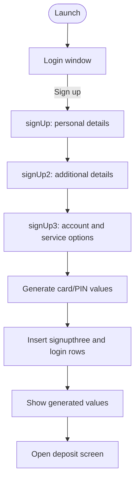
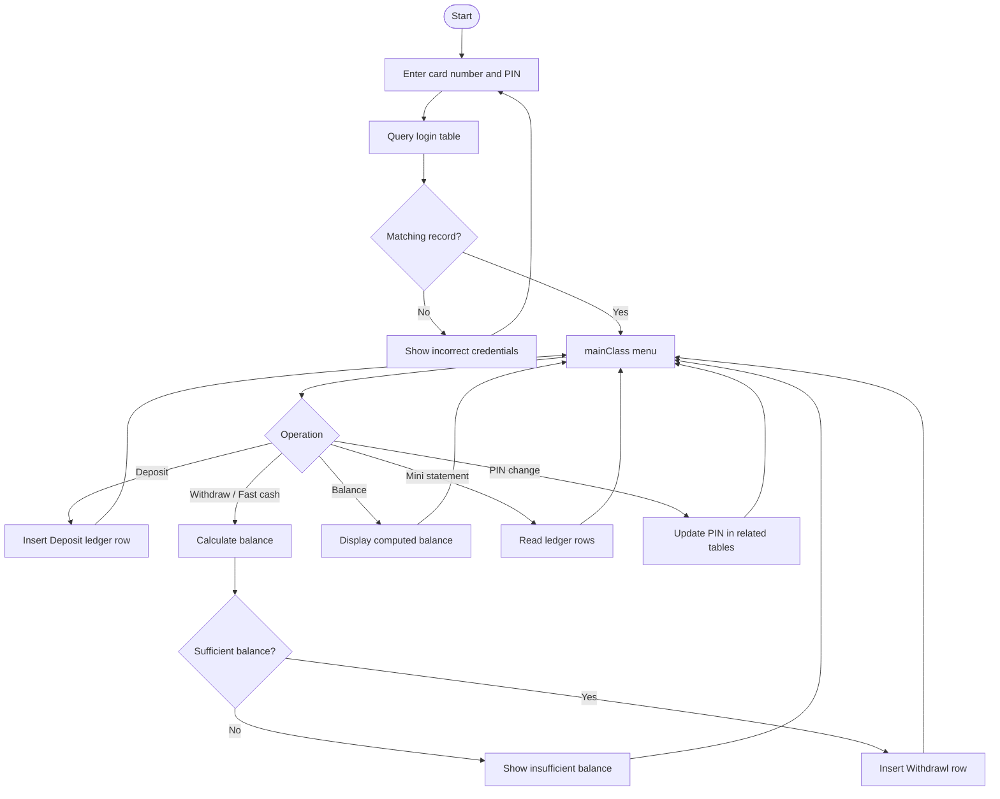
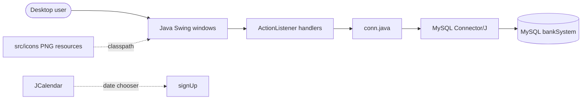
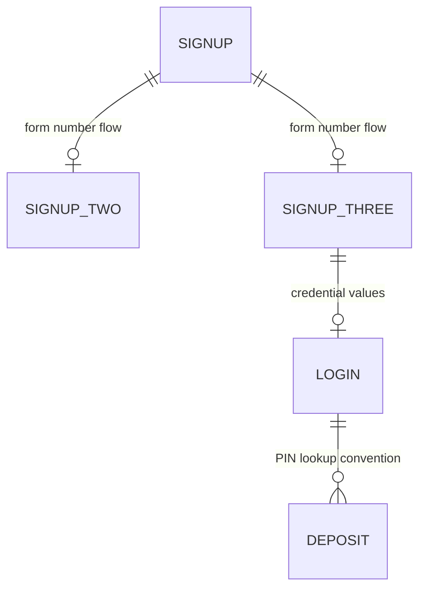

# 🏦 Bank Management System

<div align="center">

**Java Swing desktop ATM and account-registration learning project backed by MySQL**

[](https://openjdk.org/)
[](https://www.mysql.com/)
[](https://docs.oracle.com/javase/8/docs/technotes/guides/jdbc/)
[](LICENSE)
[](https://github.com/Brajesh31/Bank-Management-System/issues)
[](https://github.com/Brajesh31/Bank-Management-System/stargazers)
[](https://github.com/Brajesh31/Bank-Management-System/commits/main)

</div>

> [!CAUTION]
> **Educational prototype only. Do not use this application for real banking, customer information, or financial transactions.** The checked-in source contains a hardcoded database password, stores PINs in plain text, constructs SQL using string concatenation, and does not implement production-grade authorization or transaction controls. Read [SECURITY.md](SECURITY.md).

## 📌 Overview

Bank Management System is a desktop application built with **Java Swing**, **JDBC**, and **MySQL**. It demonstrates a multi-screen account application, card/PIN login, and ATM-style screens for deposits, withdrawals, fast cash, balance enquiry, mini statements, and PIN changes.

| Attribute | Current implementation |
|---|---|
| Application | Java desktop GUI |
| UI | Java Swing |
| Persistence | JDBC |
| Database | MySQL, database `bankSystem` |
| Entry point | `bank.management.system.login` |
| Dependencies | MySQL Connector/J 8.0.28, JCalendar 1.3.3-4 |
| Build | Direct `javac`, no Maven/Gradle manifest |
| Tests | No automated application test suite checked in |
| Intended use | Learning and local demonstration with synthetic data |

## ✨ Feature inventory

### 🧑‍💼 Account application
- Three-step registration flow for personal, additional, and account information.
- Account type and service preference selection.
- Card/PIN-like values generated by the registration screen.
- JDBC inserts into the registration and login tables.

### 💳 ATM-style operations
- Card number and PIN login.
- Deposit ledger entry.
- Cash withdrawal with a computed balance check.
- Preset fast-cash values: ₹100, ₹500, ₹1,000, ₹2,000, ₹5,000, and ₹10,000.
- Balance enquiry from transaction rows.
- Mini statement display.
- PIN update across the tables referenced by the source.

The project does not provide ATM hardware integration, payment rails, UPI, NEFT, RTGS, internet banking, or a hosted backend.

## 🖼️ Existing interface assets

| Asset | Observed use |
|---|---|
| `bank.png` | Branding on login/registration |
| `card.png` | Card image on login |
| `backbg.png` | Login background |
| `atm2.png` | ATM operation background |
| `provider.png` | Bundled image, usage should be checked before editing |

Runtime screenshots have not been verified. Diagrams below represent code flow, not screenshots.

## 🔄 Registration workflow



## 🔐 Authentication and transaction workflow



## 🧱 Architecture



The design is a small desktop application. Screen classes issue SQL directly through a helper pattern. There is no separate API or service layer in the current source.

## 📂 Project structure

```text
Bank-Management-System/
├── .github/                 # Workflows and contribution templates
├── .idea/                   # Existing IntelliJ IDEA metadata
├── bin/                     # Existing compiled .class files
├── docs/                    # Architecture, operations, security and QA guides
├── lib/                     # JDBC and JCalendar JAR files
├── src/
│   ├── bank/management/system/
│   │   ├── login.java
│   │   ├── conn.java
│   │   ├── mainClass.java
│   │   ├── signUp.java
│   │   ├── signUp2.java
│   │   ├── signUp3.java
│   │   ├── deposit.java
│   │   ├── withdraw.java
│   │   ├── fastCash.java
│   │   ├── balanceEnquiry.java
│   │   ├── mini.java
│   │   └── pin.java
│   └── icons/
├── .env.example
├── CHANGELOG.md
├── CONTRIBUTING.md
├── LICENSE
├── README.md
├── ROADMAP.md
├── SECURITY.md
└── SUPPORT.md
```

## ⚙️ Requirements

- JDK 8 or newer.
- MySQL Server.
- A graphical desktop environment.
- Git.
- Bundled dependencies under `lib/`.

## 🚀 Local setup

### 1. Clone

```bash
git clone https://github.com/Brajesh31/Bank-Management-System.git
cd Bank-Management-System
```

### 2. Create a disposable database

```sql
CREATE DATABASE bankSystem;
```

The repository does **not** include a canonical SQL schema or migration scripts. Java source references `signup`, `SignUpTwo`, `signupthree`, `login`, and `deposit`; inspect all SQL statements and define a matching local schema. See [Database guide](docs/database.md).

### 3. Configure local credentials safely

Important: `.env.example` is not loaded by the current Java code. The connection helper still hardcodes MySQL connection values in `conn.java`. Before running locally, use a dedicated low-privilege MySQL user for the disposable database and modify the connection settings locally without committing credentials. If any committed credential is active or reused, rotate it.

### 4. Compile on Windows PowerShell

```powershell
New-Item -ItemType Directory -Force out
$files = Get-ChildItem -Recurse src -Filter *.java | ForEach-Object { $_.FullName }
javac -cp "lib\mysql-connector-java-8.0.28.jar;lib\jcalendar-tz-1.3.3-4.jar;src" -d out $files
```

### 5. Launch on Windows PowerShell

```powershell
java -cp "out;src;lib\mysql-connector-java-8.0.28.jar;lib\jcalendar-tz-1.3.3-4.jar" bank.management.system.login
```

### 6. Compile and run on Linux/macOS

```bash
mkdir -p out
find src -name '*.java' -print0 | xargs -0 javac \
  -cp "lib/mysql-connector-java-8.0.28.jar:lib/jcalendar-tz-1.3.3-4.jar:src" -d out

java -cp "out:src:lib/mysql-connector-java-8.0.28.jar:lib/jcalendar-tz-1.3.3-4.jar" \
  bank.management.system.login
```

No build success is claimed here. Verify locally with your actual JDK, MySQL server, and schema.

## 🗃️ Database notes

| Table referenced in source | Observed role |
|---|---|
| `signup` | Personal registration |
| `SignUpTwo` | Additional registration |
| `signupthree` | Account type and generated card/PIN values |
| `login` | Card/PIN login |
| `deposit` | Deposit and withdrawal ledger rows |



The ERD is conceptual and inferred from values passed between screens. It is not a verified physical schema or proof of database foreign keys. Exact column types, keys, indexes and constraints are not defined by the repository.

The current balance logic adds rows whose type equals `Deposit` and subtracts every other row. It parses amount values into Java `int`, so it is not robust monetary accounting.

## 🧪 Testing

There is no checked-in automated application test suite or database fixture. Use [docs/testing.md](docs/testing.md) for the manual matrix. Test only with synthetic data.

Minimum cases: registration, valid/invalid login, positive and invalid amounts, deposits, sufficient/insufficient withdrawals, each fast-cash amount, balance consistency, mini statement, PIN change, unavailable database, and missing schema.

## 🔒 Security and privacy

Current source has serious issues:
- Hardcoded MySQL credentials.
- Plain-text PIN storage and comparison.
- SQL built by concatenating user-controlled strings.
- Incomplete monetary input validation.
- Non-atomic balance check and withdrawal insert.
- Collection of PAN/Aadhaar without a clear data-minimization and retention design.
- JDBC operations executed synchronously in Swing event handlers.

This repository is not suitable for real financial use. Read [SECURITY.md](SECURITY.md), [security review](docs/security-review.md), and [threat model](docs/threat-model.md).

## 📚 Documentation

| Guide | Purpose |
|---|---|
| [Documentation index](docs/README.md) | Complete navigation |
| [Overview](docs/overview.md) | Purpose and scope |
| [Architecture](docs/architecture.md) | Runtime and class responsibilities |
| [Project structure](docs/project-structure.md) | Files and dependencies |
| [Installation](docs/installation.md) | Local setup |
| [Configuration](docs/configuration.md) | Current and proposed config |
| [Database](docs/database.md) | Table references and schema caveats |
| [Transactions](docs/transactions.md) | Ledger behavior and integrity concerns |
| [User journeys](docs/user-journeys.md) | Screen-level flows |
| [Functional inventory](docs/functional-inventory.md) | Feature-to-class map |
| [Security review](docs/security-review.md) | Source-observed security findings |
| [Threat model](docs/threat-model.md) | Assets, boundaries and misuse cases |
| [Testing](docs/testing.md) | Manual test matrix |
| [Known issues](docs/known-issues.md) | Current limitations |
| [Commands](docs/commands.md) | Build and run commands |
| [Dependencies](docs/dependencies.md) | Bundled library register |
| [Privacy](docs/privacy.md) | Data minimization guidance |
| [Accessibility](docs/accessibility.md) | Desktop QA checklist |
| [Performance](docs/performance.md) | Responsiveness and JDBC risks |
| [Error handling](docs/error-handling.md) | Current failure behavior and target |
| [Operations](docs/operations.md) | Local maintenance |
| [Backup and recovery](docs/backup-recovery.md) | Synthetic development data guidance |
| [Deployment](docs/deployment.md) | Why public financial deployment is unsupported |
| [FAQ](docs/faq.md) | Common questions |
| [Glossary](docs/glossary.md) | Project terminology |
| [Technical debt](TECHNICAL_DEBT.md) | Prioritized engineering work |
| [Roadmap](ROADMAP.md) | Proposed phases |

## 🤝 Contributing

Read [CONTRIBUTING.md](CONTRIBUTING.md). Keep changes focused, use synthetic data, preserve existing assets, document schema changes, and describe tests honestly. For vulnerability reporting, use [SECURITY.md](SECURITY.md), not a public issue.

## 📄 License

MIT. See [LICENSE](LICENSE).

Last updated: 2026-11-16 18:31 UTC
