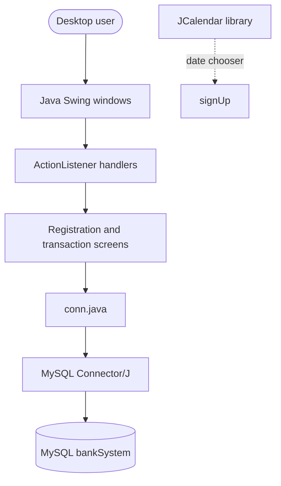

# Architecture

## System shape
A single-process Java desktop application uses Swing for presentation and JDBC for persistence. Screen classes execute SQL directly through the `conn` helper. MySQL is the persistence store.

## Class responsibilities

| Class | Observed role |
|---|---|
| `login` | Entry point; queries login table and opens menu or registration |
| `mainClass` | Main operation menu |
| `conn` | Creates JDBC connection and Statement |
| `signUp` | Personal registration and signup insert |
| `signUp2` | Additional details and signup insert |
| `signUp3` | Account/service selection, card/PIN generation and login inserts |
| `deposit` | Deposit ledger insert |
| `withdraw` | Balance calculation and withdrawal insert |
| `fastCash` | Preset withdrawal values and balance check |
| `balanceEnquiry` | Computes and displays a balance |
| `mini` | Displays card suffix and ledger rows |
| `pin` | Updates PIN in three referenced tables |

## Startup and navigation
1. `login.main` creates the login frame.
2. Sign up launches the three registration frames in sequence.
3. Login queries `login` by card number and PIN.
4. A matching row opens `mainClass`.
5. Menu selections create separate operation frames.
6. Back actions construct a new menu frame. Exit terminates the process.

## Registration boundaries
The signup pages insert data one page at a time. There is no visible transaction spanning the whole registration process. An error on a later page may leave earlier records persisted. Generated values use `java.util.Random`, not a cryptographically secure generator.

## Persistence boundaries
The helper connects to `jdbc:mysql://localhost:3306/bankSystem` and creates a plain `Statement`. SQL and data access live in UI event handlers. There is no separate service, DAO/repository, ORM, web API, or connection pool in the current source.

## Runtime and resource concerns
JDBC work occurs synchronously in event handlers and can freeze the Swing event-dispatch thread. Connections, statements, and result sets are not consistently closed. A redesign should isolate persistence, use try-with-resources, move database work to `SwingWorker`, and introduce explicit transaction boundaries.

See [technical debt](../TECHNICAL_DEBT.md).
