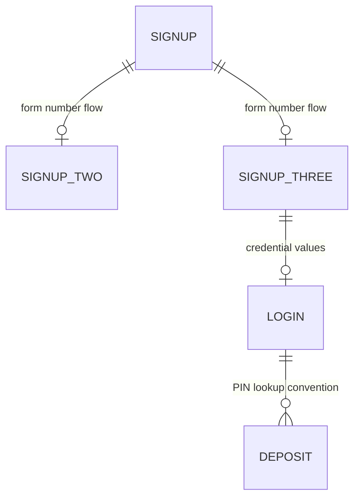

# Database Documentation

## Connection
The JDBC helper targets MySQL database `bankSystem` on localhost. The repository does not include a canonical schema, migration scripts, or a database fixture.

## Tables referenced by source

| Table | Observed data/purpose |
|---|---|
| `signup` | Form number, name, father's name, DOB, gender, email, marital status, address, city, postal code |
| `SignUpTwo` | Form number, religion, category, income, education, occupation, PAN, Aadhaar, existing-account value |
| `signupthree` | Form number, account type, card number, PIN, service preference string |
| `login` | Form number, card number, PIN |
| `deposit` | PIN, date, transaction type, amount |

These are source references, not a complete schema contract. Inserts without explicit column lists depend on physical table column order. Case varies in table references.

## Conceptual relationships

This ERD is inferred from screen flow and is not a verified physical schema or proof of foreign keys.

## Balance calculation
The UI selects ledger rows by PIN, adds rows whose type equals `Deposit`, and subtracts every other type. Amounts are parsed as Java `int`. Unknown transaction types therefore reduce balance, and malformed/out-of-range values can fail.

## Schema recommendations
- Add versioned migrations and a clean database bootstrap.
- Use stable account IDs, not PINs, as ledger foreign keys.
- Use `DECIMAL` for money.
- Add transaction IDs, timestamps, status and idempotency keys.
- Declare primary/foreign keys, indexes, uniqueness and validation constraints.
- Minimize sensitive data collection.
- Use prepared statements and database transactions.
- Never store PINs or passwords in plaintext.

Use synthetic values only.
