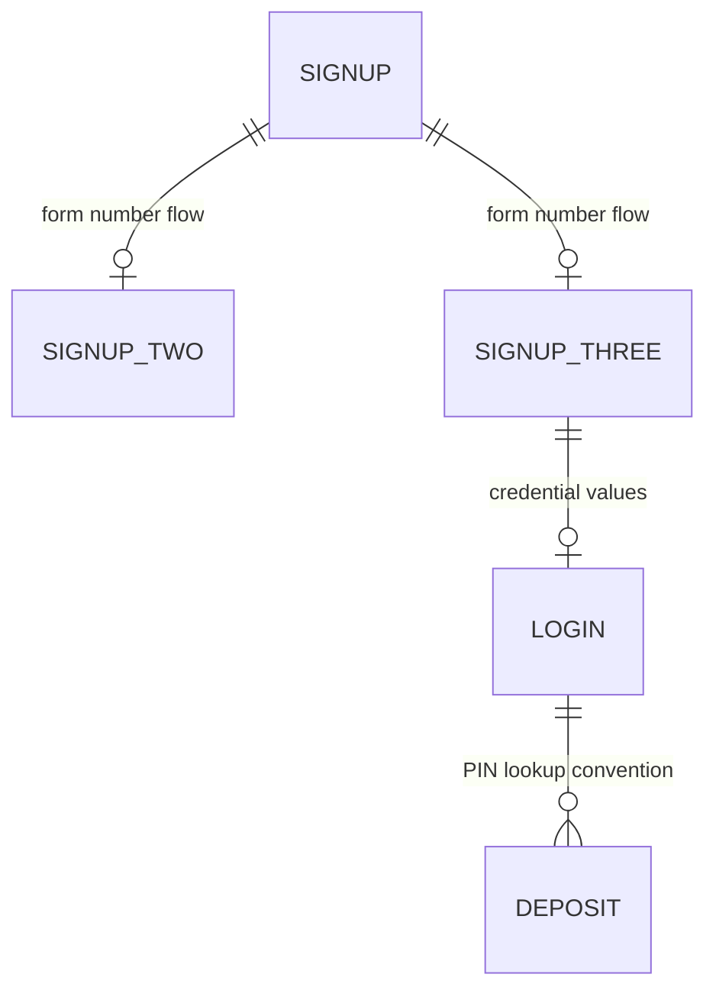

# Database Documentation

## Connection
The helper currently targets `jdbc:mysql://localhost:3306/bankSystem` using MySQL Connector/J. No canonical SQL schema, migration, or database fixture is checked in.

## Tables referenced by Java source

| Table | Observed fields/purpose |
|---|---|
| `signup` | Form number, name, father's name, DOB, gender, email, marital status, address, city, postal code |
| `SignUpTwo` | Form number, religion, category, income, education, occupation, PAN, Aadhaar, existing-account value |
| `signupthree` | Form number, account type, card number, PIN, service preference string |
| `login` | Form number, card number, PIN |
| `deposit` | PIN, date, transaction type, amount |

These are source-level references, not a complete schema contract. Insert statements often omit explicit column lists, making them dependent on table column order. Names have inconsistent capitalization.

## Conceptual relationships

This ERD is inferred from application flow. It does not establish real primary keys or foreign keys.

## Balance calculation
The UI iterates ledger rows for a PIN, adds rows where type is `Deposit`, and subtracts every other type. Values are parsed as Java `int`. Unknown transaction types are therefore treated as deductions, and overflow/invalid values can cause errors. This is not robust accounting logic.

## Schema work needed
- Create migrations with versioned, explicit DDL.
- Use stable account IDs, not PINs, for ledger linkage.
- Declare primary/foreign keys, unique constraints, indexes, and nullability.
- Use `DECIMAL` for money and explicit transaction types.
- Make ledger entries immutable and auditable.
- Add timestamps, status, idempotency, and transaction identifiers.
- Avoid collecting unnecessary identity data.
- Never store PINs or passwords in plaintext.
- Use prepared statements and database transactions.

Use fake identifiers and synthetic records only.
