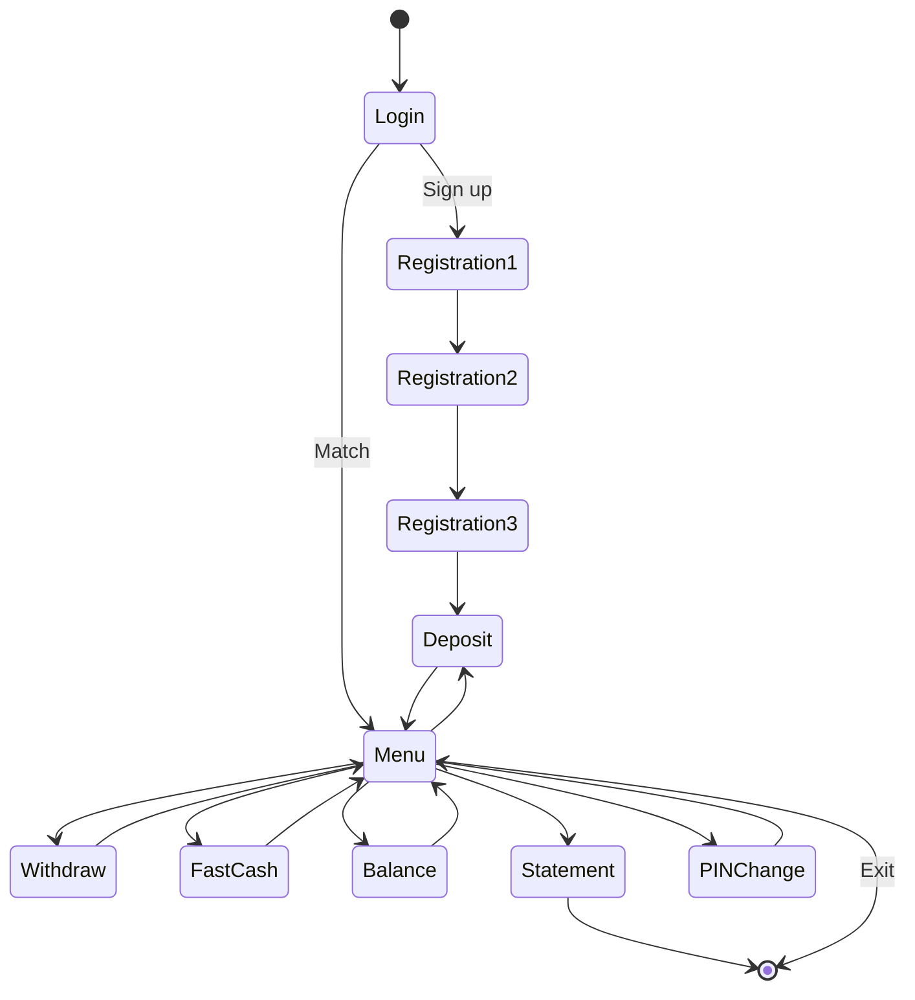

# Functional Inventory

| Feature | Class | Observed behavior | Not established |
|---|---|---|---|
| Entry/login | login | Card/PIN query and sign-up navigation | Secure authentication |
| Registration page 1 | signUp | Personal data insert | Identity verification |
| Registration page 2 | signUp2 | Additional profile insert | PAN/Aadhaar validation |
| Registration page 3 | signUp3 | Account/service selection and credential generation | Secure issuance |
| Menu | mainClass | Opens operation screens | Role authorization |
| Deposit | deposit | Inserts deposit row | Cash reconciliation |
| Withdrawal | withdraw | Computes balance and inserts withdrawal | Atomic settlement |
| Fast cash | fastCash | Preset withdrawal options | Physical ATM operation |
| Balance | balanceEnquiry | Computes ledger total | Authoritative bank balance |
| Statement | mini | Displays ledger rows | Audited statement guarantee |
| PIN change | pin | Updates three referenced tables | Secure credential lifecycle |
| Persistence | conn | JDBC connection and Statement | Pooling/secret management |

## UI state map

