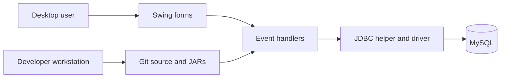

# Threat Model

## System boundary
A desktop Swing process communicates with MySQL over JDBC. UI handlers construct SQL from user values. The database credential is embedded in source.

## Assets
- Database connection credential.
- Personal registration records.
- PAN/Aadhaar fields.
- Card numbers and PIN values.
- Transaction history and computed balances.
- Java source and bundled dependencies.

## Trust boundaries
1. User input enters Swing forms.
2. Event handlers build SQL.
3. Application authenticates to MySQL with a source-controlled credential.
4. Database results are trusted by UI calculations.
5. Git distributes source and binaries.

## Abuse cases

| Threat | Existing weakness | Consequence |
|---|---|---|
| SQL injection | String-concatenated SQL | Data disclosure or modification |
| Credential theft | Hardcoded DB password | Unauthorized database access |
| PIN theft | Plain-text PIN values | Account impersonation |
| Concurrent withdrawals | Non-atomic check/write | Incorrect ledger balance |
| Accidental data commit | Sensitive fields and dumps | Personal-data exposure |
| Dependency tampering | Bundled JARs without integrity checks | Runtime compromise |

## Existing limited controls
The login uses a password field and mini statement masks much of the card number. These UI choices do not protect stored credentials or database access.

## Required controls
Externalized secrets, prepared statements, credential hashing, least privilege, stable account IDs, atomic ledger writes, amount validation, data minimization, encrypted transport/storage, audit controls, backups, and dependency integrity checks.

Residual risk remains critical until the underlying source is redesigned and tested.
