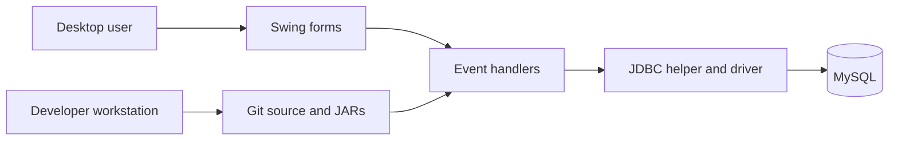

# Threat Model

## System boundary
A desktop Swing process uses JDBC to communicate with MySQL. User-entered values are incorporated into SQL by screen handlers. The database credential is embedded in source.

## Assets
- MySQL connection credential.
- Personal registration records.
- PAN/Aadhaar fields.
- Card numbers and PIN values.
- Transaction rows and computed balances.
- Source and bundled dependency binaries.

## Trust boundaries
1. Text and selections supplied by the user.
2. Event handler constructing SQL.
3. Application process authenticating to MySQL.
4. Database response trusted by presentation logic.
5. Public repository containing source and binaries.

## Abuse cases

| Threat | Existing weakness | Potential consequence |
|---|---|---|
| SQL injection | String-concatenated SQL | Data disclosure or modification |
| Credential theft | Embedded DB password | Unauthorized database access |
| PIN compromise | Plain-text PINs | Account impersonation |
| Concurrent requests | Non-atomic balance check | Incorrect ledger balance |
| Accidental data commit | Broad personal-data collection | Identity exposure |
| Dependency tampering | Bundled JARs without integrity register | Runtime compromise |

## Limited existing controls
The login screen uses a password field, and the mini statement masks most of the card number. These do not secure stored credentials, authorize database operations, or protect data at rest.

## Required improvements
Externalized secrets, prepared statements, credential hashing, least-privilege DB account, stable account IDs, atomic ledger writes, input validation, data minimization, encrypted transport/storage, audit records, backup controls, and dependency integrity checks.

Residual risk remains critical until the source-level issues are fixed and verified.
