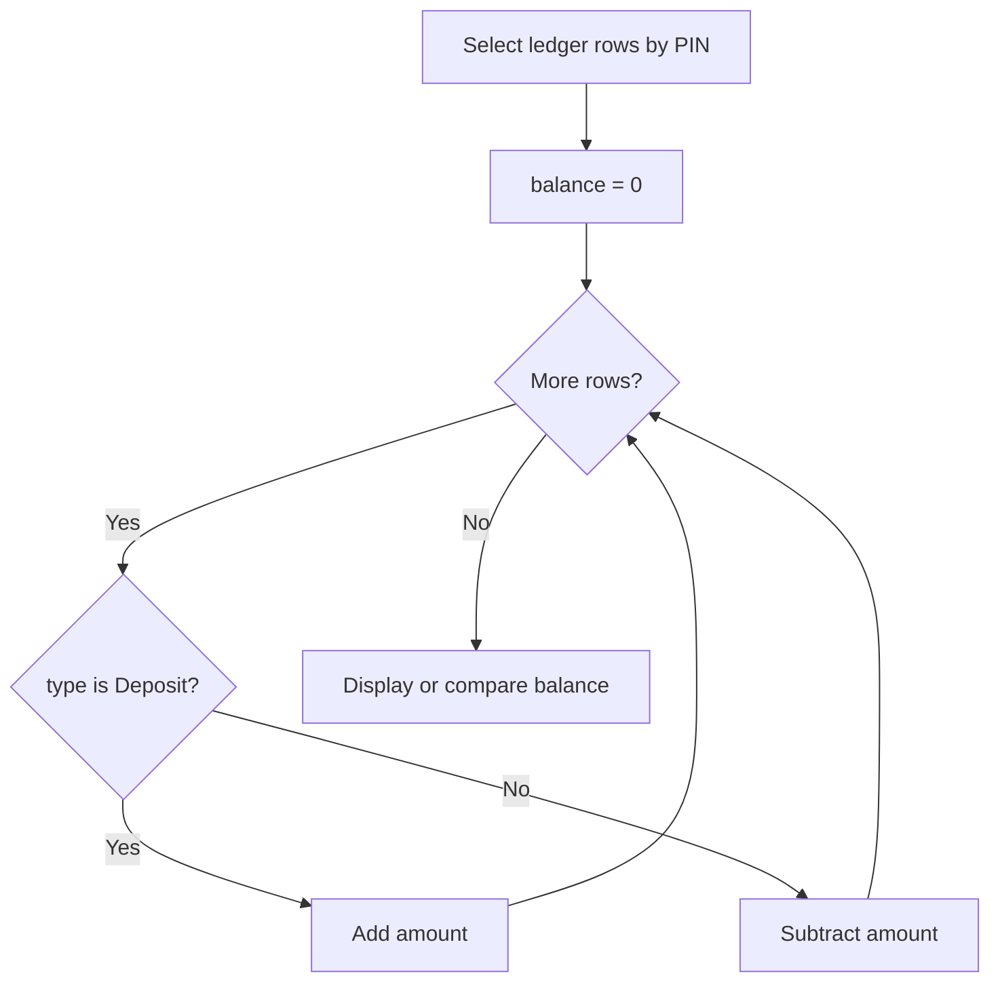

# Transaction Behavior

## Current operations

- `deposit` inserts a row with type `Deposit`.
- `withdraw` reads ledger rows for the current PIN, calculates balance, and inserts a `Withdrawl` row if the request does not exceed that balance.
- `fastCash` offers preset amounts (100, 500, 1,000, 2,000, 5,000, 10,000) and follows the same balance-check pattern.
- `balanceEnquiry` calculates a balance from ledger rows.
- `mini` displays rows and the calculated total.

## Current arithmetic

In simplified form: deposits are added and every other transaction type is subtracted.

## Correctness risks
- The implementation uses `int` parsing rather than a money type.
- Empty input is checked in some places, but positive integer validation is incomplete.
- Malformed or oversized values can fail parsing or overflow.
- Unknown transaction types are treated as withdrawals.
- Balance read and withdrawal insert are separate SQL statements.
- Concurrent withdrawals can pass the same balance check.
- Ledger rows are keyed by PIN, not a stable account identifier.
- Database failure handling may leave ambiguous UI state.

## Safer target design
Use `BigDecimal`, strict input validation, stable account IDs, immutable transaction IDs, idempotency, audit data, and atomic database transactions with concurrency protection. Test rollback and concurrent withdrawals using synthetic accounts. This guide is not an accounting or banking specification.
