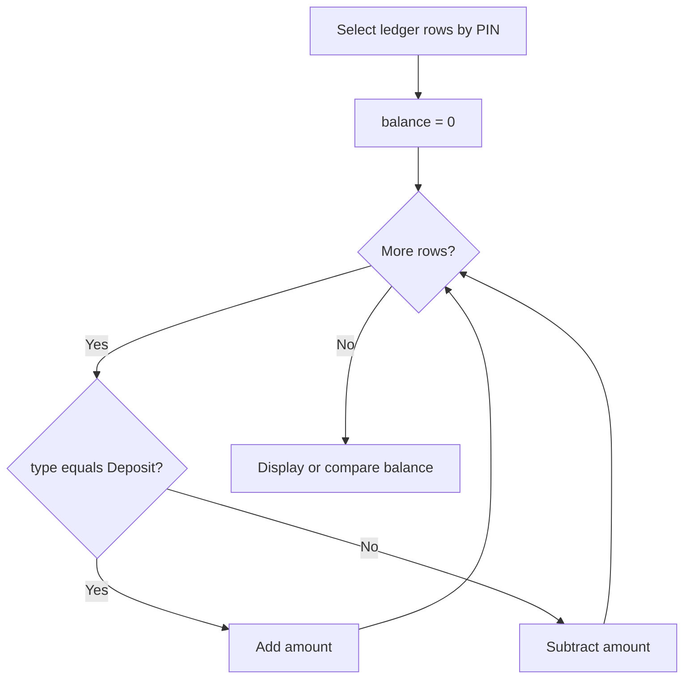

# Transaction Behavior

## Current screens
- `deposit` inserts a row with type `Deposit`.
- `withdraw` reads ledger rows for the current PIN, calculates balance, and inserts `Withdrawl` if sufficient.
- `fastCash` offers preset amounts of 100, 500, 1,000, 2,000, 5,000 and 10,000 and follows the same check.
- `balanceEnquiry` computes a balance from ledger rows.
- `mini` displays ledger entries and the computed total.

## Current arithmetic

In simplified form: deposits are added and every other type is subtracted.

## Correctness risks
- Java `int` is used instead of a money type.
- Positive integer validation is incomplete.
- Malformed or oversized values can fail parsing or overflow.
- Unknown transaction types become deductions.
- Balance read and withdrawal insert are separate statements.
- Concurrent withdrawals can pass the same check.
- Ledger linkage uses PIN instead of a stable account ID.
- Database errors can leave ambiguous UI state.

## Safer target
Use `BigDecimal`, strict validation, stable account IDs, immutable transaction IDs, idempotency, audit records, and atomic transactions with concurrency protection. Test rollback and concurrent requests with synthetic records. This is not an accounting specification.
